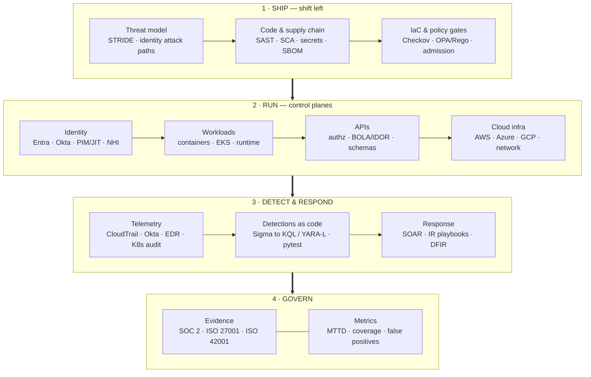

<picture>
  <source media="(prefers-color-scheme: dark)" srcset="https://raw.githubusercontent.com/kelvinodarikpe88/kelvinodarikpe88/main/assets/banner-dark.svg?v=2">
  <source media="(prefers-color-scheme: light)" srcset="https://raw.githubusercontent.com/kelvinodarikpe88/kelvinodarikpe88/main/assets/banner-light.svg?v=2">
  
</picture>

 

[**Architecture model**](docs/ARCHITECTURE.md) · [**Portfolio index**](docs/PORTFOLIO.md) · [**LinkedIn**](https://www.linkedin.com/in/kelvinodarikpe/) · [**Email**](mailto:kelvinodarikpe88@gmail.com)

---

I build security controls that survive contact with production: authorization that is tested rather than assumed, detections that are versioned and regression-tested like software, cloud infrastructure that fails closed when someone hand-edits it, and identity that grants access for minutes instead of quarters.

Seven years across SOC operations (L1–L3), detection engineering, application security and cloud security — usually the person who both designs the control and writes the code that proves it works. My default deliverable is not a document; it is a repo with a test suite, a CI gate and a runbook attached.

**What that looks like in practice**

- **Application security that blocks merges, not audits.** Threat models that turn into OPA/Rego gates, SAST/SCA/secret scanning wired into the pipeline, vulnerability triage driven by EPSS + CISA KEV instead of raw CVSS.
- **Detection engineering as software delivery.** Sigma and YARA-L rules in Git, unit-tested against real telemetry shapes, compiled to KQL for Sentinel, coverage recomputed against MITRE ATT&CK on every push.
- **Cloud and infrastructure security by construction.** Landing-zone guardrails, IaC policy gates, CloudTrail/GuardDuty/Activity/Audit Log pipelines with retention that maps to DORA, NIS2 and PCI-DSS obligations.
- **Identity as the primary control plane.** PIM vs standing privilege detection, Conditional Access baseline auditing, JML automation, and the non-human identities (service accounts, workload identities, agents) that most access reviews forget.

---

## The model I build against

Four planes, one feedback loop. Every repo below maps to a cell in this model — not to a tool list.

The loop that closes the model: **every incident becomes a test case, and every repeated gap becomes a policy.** Detection without that feedback is a cost centre; with it, it is how the architecture gets better.

| Plane | Control objective | Where it is implemented |
|---|---|---|
| **Identity** | No standing privilege; access is time-bound, reviewed and attributable | [identity-security-lab](https://github.com/kelvinodarikpe88/identity-security-lab) · [04-identity-security-architecture](https://github.com/kelvinodarikpe88/04-identity-security-architecture) · [08-iam-privilege-auditor](https://github.com/kelvinodarikpe88/08-iam-privilege-auditor) |
| **Workloads** | A compromised container cannot escalate, persist or reach the control plane | [container-security-lab](https://github.com/kelvinodarikpe88/container-security-lab) · [07-cloud-detection-lab](https://github.com/kelvinodarikpe88/07-cloud-detection-lab) |
| **APIs** | Every object is authorized server-side, per tenant, per verb | [vulnbank](https://github.com/kelvinodarikpe88/vulnbank) · [bugbounty-asset-recon-pipeline](https://github.com/kelvinodarikpe88/bugbounty-asset-recon-pipeline) |
| **Cloud infrastructure** | Drift is detected and reverted; audit logs are complete and tamper-evident | [cloud-log-integration-aws](https://github.com/kelvinodarikpe88/cloud-log-integration-aws) · [07-cloud-security-posture-management](https://github.com/kelvinodarikpe88/07-cloud-security-posture-management) · [cloud-soc-detection-lab](https://github.com/kelvinodarikpe88/cloud-soc-detection-lab) |
| **Detection** | Every rule has a test, an owner, an ATT&CK mapping and an FP budget | [detection-engineering](https://github.com/kelvinodarikpe88/detection-engineering) · [detection-as-code-cicd](https://github.com/kelvinodarikpe88/detection-as-code-cicd) · [mitre-attack-coverage-tracker](https://github.com/kelvinodarikpe88/mitre-attack-coverage-tracker) |
| **Response** | Containment is pre-approved, reversible and evidenced | [05-incident-response-orchestration](https://github.com/kelvinodarikpe88/05-incident-response-orchestration) · [cloud-forensics-ir-playbook](https://github.com/kelvinodarikpe88/cloud-forensics-ir-playbook) |
| **Governance** | Controls produce evidence continuously, not the week before the audit | [02-ai-security-compliance](https://github.com/kelvinodarikpe88/02-ai-security-compliance) · [audit-logging-compliance-checker](https://github.com/kelvinodarikpe88/audit-logging-compliance-checker) |

Full reasoning, trust boundaries and threat model: **[docs/ARCHITECTURE.md](docs/ARCHITECTURE.md)**

---

## Application security

The part of the job I care most about: making the secure path the path of least resistance for engineers who have a deadline.

| Layer | What I build | Repo |
|---|---|---|
| **Design** | STRIDE per trust boundary, abuse cases, identity attack-path graphs, security requirements as acceptance criteria | [devsecops-security-engineering-projects](https://github.com/kelvinodarikpe88/devsecops-security-engineering-projects) |
| **Build** | SAST (Semgrep/CodeQL), SCA (Trivy/OSV/Snyk), secret scanning (Gitleaks), SBOM + signing, DAST (ZAP), all failing the build on policy | [appsec-devsecops-pipeline](https://github.com/kelvinodarikpe88/appsec-devsecops-pipeline) · [09-devsecops-pipeline-security](https://github.com/kelvinodarikpe88/09-devsecops-pipeline-security) |
| **Prove** | Deliberately vulnerable target app — SQLi, unsigned JWT, IDOR, XSS — used to validate that the gates actually catch what they claim | [vulnbank](https://github.com/kelvinodarikpe88/vulnbank) |
| **Triage** | Exploitability-led prioritisation: CVSS v3.1 + EPSS + CISA KEV + reachability, deduplicated PoC evidence | [vulnerability-management-lab](https://github.com/kelvinodarikpe88/vulnerability-management-lab) · [soar-vulnerability-enrichment-bot](https://github.com/kelvinodarikpe88/soar-vulnerability-enrichment-bot) |

Operating principle: a scanner finding nobody can reproduce is noise. Every finding ships with a reproduction, an owner and a deadline derived from exploitability — not from a vendor severity label.

---

## Security architecture

Architecture is where I try to spend my credibility: choosing the boundary, then proving the boundary holds under failure.

- **Identity-first threat modelling.** Model the attack path (`user → role → workload identity → control plane`), then remove the edge rather than adding a monitor on top of it.
- **Zero-trust segmentation.** Conditional Access and device-compliance signals as the enforcement point; legacy auth blocked by default; risk-based step-up instead of static VPN trust.
- **Policy as code.** The architecture diagram and the OPA/Rego policy are the same artefact — if it is not enforced in CI and at admission time, it is documentation, not a control.
- **Failure modes designed, not discovered.** What happens when the IdP is down, the log pipeline backs up, or a break-glass account is used at 03:00 — written before the incident.

Reference implementation: [04-identity-security-architecture](https://github.com/kelvinodarikpe88/04-identity-security-architecture) — MSAL Graph client, PIM-vs-standing-role detection, Conditional Access baseline audit, Terraform policy layer, OPA least-privilege policy, pytest + CI.

---

## Detection engineering & security operations

| Capability | Approach | Repo |
|---|---|---|
| **Rule lifecycle** | Sigma/YARA-L in Git → lint → unit test → compile to KQL → deploy → measure FP rate | [detection-engineering](https://github.com/kelvinodarikpe88/detection-engineering) · [detection-as-code-cicd](https://github.com/kelvinodarikpe88/detection-as-code-cicd) |
| **Coverage** | ATT&CK technique → telemetry source → rule → test case, gaps reported as data not opinion | [mitre-attack-coverage-tracker](https://github.com/kelvinodarikpe88/mitre-attack-coverage-tracker) |
| **Identity detection** | Okta SystemLog + Google Workspace + Entra: impossible travel, MFA fatigue, token replay, OAuth consent abuse | [identity-threat-detection-okta-gws](https://github.com/kelvinodarikpe88/identity-threat-detection-okta-gws) · [identity-security-lab](https://github.com/kelvinodarikpe88/identity-security-lab) |
| **Cloud detection** | CloudTrail/GuardDuty behaviour, crypto-mining, anomalous `AssumeRole` chains, S3 exposure | [cloud-soc-detection-lab](https://github.com/kelvinodarikpe88/cloud-soc-detection-lab) · [cloudtrail-anomaly-detector](https://github.com/kelvinodarikpe88/cloudtrail-anomaly-detector) |
| **Hunting** | Hypothesis-driven hunts mapped to TTPs, results feeding back into rules | [portfolio-secops-detections](https://github.com/kelvinodarikpe88/portfolio-secops-detections) · [cti-threat-hunting-simulation](https://github.com/kelvinodarikpe88/cti-threat-hunting-simulation) |
| **Operations** | L1–L3 SOPs, escalation matrices, comms templates, post-incident rule updates | [soc-l2-l3-sop-playbooks](https://github.com/kelvinodarikpe88/soc-l2-l3-sop-playbooks) · [10-security-operations-sop](https://github.com/kelvinodarikpe88/10-security-operations-sop) |

The production-equivalent stack — Sentinel/KQL, Elastic, Entra/Okta/Intune, Tenable/Qualys finding model — is documented, with the production/lab boundary stated explicitly, in [enterprise-soc-production-stack](https://github.com/kelvinodarikpe88/enterprise-soc-production-stack).

---

## Cloud security & cloud infrastructure

| Domain | What I build | Repo |
|---|---|---|
| **Posture** | Multi-cloud CIS scanning with auto-remediation, drift detection, SOC 2 / PCI-DSS reporting | [07-cloud-security-posture-management](https://github.com/kelvinodarikpe88/07-cloud-security-posture-management) · [cspm-platform](https://github.com/kelvinodarikpe88/cspm-platform) |
| **Telemetry** | CloudTrail/GuardDuty, Azure Activity + Defender, GCP Audit + SCC → normalised, retained, queryable | [cloud-log-integration-aws](https://github.com/kelvinodarikpe88/cloud-log-integration-aws) · [cloud-log-integration-azure](https://github.com/kelvinodarikpe88/cloud-log-integration-azure) · [cloud-log-integration-gcp](https://github.com/kelvinodarikpe88/cloud-log-integration-gcp) |
| **Infrastructure as code** | Terraform/CloudFormation with policy gates that reject public buckets, open SGs and unencrypted volumes pre-merge | [aws-security-log-pipeline](https://github.com/kelvinodarikpe88/aws-security-log-pipeline) · [02-iac-security-gate](https://github.com/kelvinodarikpe88/02-iac-security-gate) |
| **Retention & integrity** | Continuous checks that log retention, immutability and chain-of-custody satisfy DORA / PCI-DSS / NIS2 | [audit-logging-compliance-checker](https://github.com/kelvinodarikpe88/audit-logging-compliance-checker) · [compliance-audit-dora-pci-forensics](https://github.com/kelvinodarikpe88/compliance-audit-dora-pci-forensics) |
| **Hybrid identity surface** | M365 / SharePoint / Entra conditional access, sharing policy and external-access review | [m365-sharepoint-security-lab](https://github.com/kelvinodarikpe88/m365-sharepoint-security-lab) |

---

## Identity, access & non-human identity

Identity is the highest-leverage control plane in a cloud-native estate, and the one most often reviewed annually and violated daily.

- **PIM eligibility vs standing assignment** — treat any high-privilege role held as a standing assignment as critical, regardless of holder or age. Implemented in [04-identity-security-architecture](https://github.com/kelvinodarikpe88/04-identity-security-architecture).
- **Conditional Access baseline auditing** — re-derive compliance from live policy state on every run instead of trusting a one-time configuration.
- **JML automation** — joiner/mover/leaver provisioning to ~84% automated across Entra ID, Okta and Google Workspace, with access reviews that produce evidence.
- **Privilege escalation paths** — `iam:PassRole` → admin, AD privileged group membership, service-account key sprawl: [08-iam-privilege-auditor](https://github.com/kelvinodarikpe88/08-iam-privilege-auditor) · [ads-privileged-group-addition](https://github.com/kelvinodarikpe88/ads-privileged-group-addition)
- **Non-human identity** — service accounts, workload identities, API keys and MCP/agent identities: owner, scope, rotation, last-used. This is the gap I see most often in audit findings.

---

## Workload, container & Kubernetes security

- **Admission and runtime** — policy at admission (no `:latest`, no privileged, no hostPath, resource limits required) plus runtime detection for shell-in-container, unexpected egress and crypto-mining.
- **Supply chain** — image scanning, SBOM generation, signature verification, and provenance before an image is allowed to run.
- **Kubernetes audit telemetry** — API server audit logs normalised into the same detection pipeline as cloud and identity events, so a `create pods/exec` is correlated with the identity that did it.
- **Blast radius** — namespace isolation, network policy defaults, workload identity instead of node-level credentials.

Repos: [container-security-lab](https://github.com/kelvinodarikpe88/container-security-lab) · [07-cloud-detection-lab](https://github.com/kelvinodarikpe88/07-cloud-detection-lab) · [09-devsecops-pipeline-security](https://github.com/kelvinodarikpe88/09-devsecops-pipeline-security)

---

## API & attack surface security

APIs are where authorization bugs become data breaches, so this is where I test hardest.

| Focus | Method | Repo |
|---|---|---|
| **Object-level authorization** | Two-tenant harness: replay every documented request as tenant B against tenant A's object IDs; diff documented vs observed behaviour | [vulnbank](https://github.com/kelvinodarikpe88/vulnbank) · `idor_check.py` in the AppSec tooling |
| **Surface discovery** | Subdomain → port → HTTP fingerprint → endpoint inventory → parameter discovery, deduplicated and scoped | [bugbounty-asset-recon-pipeline](https://github.com/kelvinodarikpe88/bugbounty-asset-recon-pipeline) · [bugbounty-recon-vulnerability-enrichment](https://github.com/kelvinodarikpe88/bugbounty-recon-vulnerability-enrichment) |
| **AuthN/AuthZ review** | Token handling, JWT algorithm confusion, scope/role confusion, machine-to-machine credentials, OAuth consent grants | [vulnbank](https://github.com/kelvinodarikpe88/vulnbank) |
| **API-shaped machine interfaces** | MCP servers and agent tool surfaces treated as authenticated APIs with their own threat model | [mcp-threat-hunting-agent](https://github.com/kelvinodarikpe88/mcp-threat-hunting-agent) · [mcp-dfir-investigation-copilot](https://github.com/kelvinodarikpe88/mcp-dfir-investigation-copilot) |

---

## AI, LLM & agent security

- **AI governance with evidence** — ISO/IEC 42001 AIMS control matrix, model cards, risk classification, drift and fairness checks wired into CI: [02-ai-security-compliance](https://github.com/kelvinodarikpe88/02-ai-security-compliance).
- **LLM application threat model** — OWASP Top 10 for LLM Applications and MITRE ATLAS mapped onto retrieval, context assembly, tool calling and agent loops; indirect prompt injection treated as an input-validation problem with a tenant-isolation blast radius.
- **AI inside the SOC** — enrichment and triage copilots that keep a human approval gate on every containment action: [secops-soar-ai-enrichment](https://github.com/kelvinodarikpe88/secops-soar-ai-enrichment).

---

## Incident response & DFIR

NIST 800-61 lifecycle with evidence handling that survives a regulator's questions.

[05-incident-response-orchestration](https://github.com/kelvinodarikpe88/05-incident-response-orchestration) · [cloud-forensics-ir-playbook](https://github.com/kelvinodarikpe88/cloud-forensics-ir-playbook) · [dfir-timeline-super-builder](https://github.com/kelvinodarikpe88/dfir-timeline-super-builder) · [memory-forensics-volatility3-automator](https://github.com/kelvinodarikpe88/memory-forensics-volatility3-automator) · [evtx-ransomware-hunting-engine](https://github.com/kelvinodarikpe88/evtx-ransomware-hunting-engine) · [pcap-traffic-carver-zeek](https://github.com/kelvinodarikpe88/pcap-traffic-carver-zeek) · [mac-linux-forensics-collector](https://github.com/kelvinodarikpe88/mac-linux-forensics-collector)

---

## Signals I can defend

| Signal | Result | Mechanism |
|---|---|---|
| Mean time to detect | **−62%** | Detections as tested, versioned code; tuning driven by measured FP populations |
| Detection false positives | **12% → 6%** | Rules regression-tested against real telemetry shapes before deploy |
| Standing privileged access | **−68%** | PIM/JIT eligibility replacing permanent role assignment |
| Critical vulnerabilities open | **847 → 187** | Exploitability-led triage (EPSS + KEV) with owner and deadline per finding |
| Remediation cycle time | **67 → 12 days** | Policy gates at merge time instead of quarterly audits |
| Joiner / Mover / Leaver | **84% automated** | IdP-driven lifecycle with evidence output per change |
| SOC 2 Type II | **zero exceptions** | Controls generate evidence continuously |
| Detection change gate | **pytest on every rule change** | No rule reaches production without a passing test |

Scope note: these are outcomes from production roles, not from the public labs in this account. Lab and design work is labelled as such throughout — see [Working principles](#working-principles).

---

## Toolchain

**Languages & delivery**

**Cloud & infrastructure**

**Application security**

**Detection & response**

**Identity**

---

## Verified credentials

| Credential | Detail | Status |
|---|---|---|
| **CompTIA Security+ ce** | SY0-701 · candidate ID `COMP001023125614` · verify `76e43bf5abcb4e299b54947fb5dcca10` | Active 2026-09-30 → 2029-09-30 |
| **ISO/IEC 27001 · 42001 · NIST CSF · SOC 2 · DORA · NIS2 · PCI-DSS** | Applied in the repos above, not just cited | Working knowledge |
| **In progress** | CISM · AWS Certified Security – Specialty · ISO/IEC 42001 Lead Implementer | — |

Verify at `cp.certmetrics.com/CompTIA/en/public/verify/credential`.

---

<b>Full portfolio index — every repo, grouped by domain</b>

 

See **[docs/PORTFOLIO.md](docs/PORTFOLIO.md)** for the maintained index with maturity level (tested / lab / design), stack and what each repo demonstrates.

| Domain | Repositories |
|---|---|
| AppSec & DevSecOps | `appsec-devsecops-pipeline` · `09-devsecops-pipeline-security` · `devsecops-pipeline-automation` · `vulnbank` · `vulnerability-management-lab` |
| Security architecture | `04-identity-security-architecture` · `enterprise-soc-production-stack` · `security-portfolio` |
| Detection engineering | `detection-engineering` · `detection-as-code-cicd` · `01-detection-as-code-pipeline` · `mitre-attack-coverage-tracker` · `portfolio-secops-detections` · `06-beacon-detector` |
| Cloud security & infra | `cloud-log-integration-aws` · `cloud-log-integration-azure` · `cloud-log-integration-gcp` · `07-cloud-security-posture-management` · `cspm-platform` · `cloud-soc-detection-lab` · `aws-security-log-pipeline` · `02-iac-security-gate` |
| Identity & NHI | `identity-security-lab` · `identity-threat-detection-okta-gws` · `08-iam-privilege-auditor` · `ads-privileged-group-addition` |
| Workloads & containers | `container-security-lab` · `07-cloud-detection-lab` · `endpoint-security-lab` |
| APIs & attack surface | `bugbounty-asset-recon-pipeline` · `bugbounty-recon-vulnerability-enrichment` · `network-security-logs-lab` |
| AI / LLM / MCP | `02-ai-security-compliance` · `mcp-threat-hunting-agent` · `mcp-dfir-investigation-copilot` · `secops-soar-ai-enrichment` |
| IR & DFIR | `05-incident-response-orchestration` · `cloud-forensics-ir-playbook` · `dfir-timeline-super-builder` · `evtx-ransomware-hunting-engine` · `memory-forensics-volatility3-automator` · `pcap-traffic-carver-zeek` · `mac-linux-forensics-collector` |
| Threat intelligence | `misp-threat-intel-sharing` · `cti-platform` · `cti-misp-sync-engine` · `cti-threat-hunting-simulation` |
| Governance & assurance | `audit-logging-compliance-checker` · `compliance-audit-dora-pci-forensics` · `10-security-operations-sop` · `soc-l2-l3-sop-playbooks` |

---

## Working principles

1. **A control that is not enforced is a wish.** Policy lives in code, runs in CI, and blocks the merge.
2. **Every detection ships with a test and an owner.** A rule without both is technical debt with an alert attached.
3. **Least privilege is a runtime property, not a diagram.** Measure standing access continuously; assume it will drift.
4. **Evidence is a by-product, not a project.** If audit evidence has to be assembled by hand, the control is manual.
5. **Say what is lab and what is production.** The boundary is labelled on every repo here — a portfolio that overstates itself is a liability, not an asset.

> **Scope of this account.** Everything public here is lab, reference implementation or design work built on synthetic data. No employer code, tenant exports, customer telemetry or audit evidence is published. Where a repo mirrors a production pattern, the readme states which parts are production-equivalent and which are not.

---

**Open to Application Security, Security Architecture, Detection Engineering and Cloud Security roles — Berlin or remote (English working environment).**

[LinkedIn](https://www.linkedin.com/in/kelvinodarikpe/) · [kelvinodarikpe88@gmail.com](mailto:kelvinodarikpe88@gmail.com) · Berlin, Germany

Profile last rebuilt October 2026 · content is versioned, typos are not

