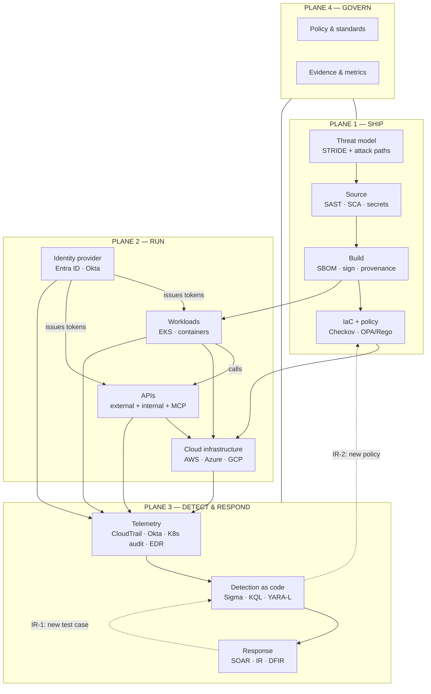
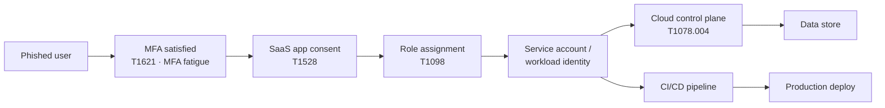
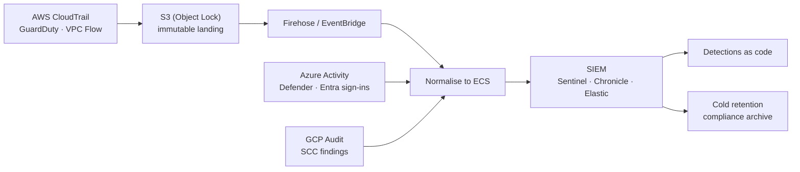

# Security Architecture Reference Model

**Kelvin Odarikpe** · Berlin · last revised October 2026

This document is the reasoning behind the repos in this account. It is a working reference model, not a certificate claim: four planes, explicit trust boundaries, a threat model per boundary, and a stated answer to "what happens when this control fails".

Read it top-down. Each plane section ends with the repos that implement it and the failure mode I design for.

---

## 1. Design axioms

1. **Identity is the control plane.** In a cloud-native estate, the network perimeter is a routing convenience. Every meaningful authorization decision resolves to an identity, a role and a scope — so identity gets the strictest design attention and the most telemetry.
2. **Enforce at the earliest reliable point.** Policy at admission (CI, Kubernetes admission, IdP sign-in) beats policy at runtime, which beats policy in a quarterly review. Enforcement points that can be bypassed by a determined engineer are not controls.
3. **Every control must fail in a known direction.** "Fails closed" is a design decision with an operational cost; so is "fails open". Both are acceptable when chosen deliberately and documented with a break-glass path.
4. **Evidence is generated, not assembled.** If producing audit evidence requires a person to take screenshots, the control is manual and will decay.
5. **Detection is software.** Rules have versions, owners, tests, review and rollback. A rule without a regression test is an untested hypothesis running in production.

---

## 2. Planes and trust boundaries

| # | Boundary | Crossing | What must be true |
|---|---|---|---|
| B1 | Engineer → source | merge | No credential in the diff; SAST/SCA gate passed; dependency provenance known |
| B2 | Source → production | deploy | Signed artefact; IaC policy passed; change traceable to an approved intent |
| B3 | Internet → API | request | Token validated server-side; object authorized per tenant and verb; input validated; rate limited |
| B4 | Workload → cloud control plane | API call | Workload identity, scoped role, no long-lived keys, no wildcard actions |
| B5 | Workload → workload | east-west | Namespaced network policy default-deny; mTLS or workload identity for service auth |
| B6 | Human → privileged action | elevation | Time-bound (PIM/JIT), approved, recorded, reverted automatically |
| B7 | Agent / automation → tool | tool call | Scoped credential, allow-listed action set, human gate on irreversible actions |
| B8 | Platform → SIEM | log ingest | Complete, correctly clocked, tamper-evident, retained per obligation |

B3 and B7 are the boundaries most often under-designed in 2026: APIs because authorization is easy to implement per-endpoint and hard to implement per-object, and agent tool calls because they inherit a human's credential set.

---

## 3. Threat model

### 3.1 STRIDE per boundary

| Boundary | Spoofing | Tampering | Repudiation | Info disclosure | DoS | Elevation |
|---|---|---|---|---|---|---|
| **B1 source** | Stolen developer token / unsigned commit | Force-push, dependency confusion | Missing review trail | Secret in history, over-broad CI token | — | Malicious CI workflow |
| **B2 deploy** | Unsigned image pulled | Tag mutability, IaC drift | No deploy attribution | Secrets in build logs | Deploy storm | Over-privileged pipeline role |
| **B3 API** | Token forgery, JWT alg confusion | Mass assignment, parameter pollution | No request-id correlation | **BOLA/IDOR**, verbose errors | Unbounded pagination | BFLA — calling an admin verb as a user |
| **B4 workload→cloud** | IMDS credential theft | Role assumption chain | CloudTrail gap | Over-broad `s3:Get*` | API throttling | `iam:PassRole` → admin |
| **B5 east-west** | Service impersonation | Request smuggling | No mTLS identity | Lateral movement | Resource exhaustion | Container escape → node |
| **B6 privilege** | MFA fatigue, token replay | Role assignment without approval | Break-glass unlogged | Standing access to sensitive data | — | Permanent Global Admin |
| **B7 agent→tool** | Forged tool result | Prompt injection → tool misuse | Agent action not attributable | Context leak across tenants | Tool-call loop | Scope creep through chained tools |
| **B8 telemetry** | Log source impersonation | Log deletion / retention shortfall | Missing clock sync | PII in logs | Ingest backpressure | Disabling the pipeline |

### 3.2 Identity attack paths

The model is a graph: `principal → authentication → role/scope → resource → data`. Detection without this graph produces alerts; architecture with it produces removals.

Every edge in that chain is either removed by design (no standing role to assign, no long-lived service account key) or instrumented by a detection. Where an edge cannot be removed — a human must eventually hold Global Admin — it is gated (PIM + approval + auto-expiry) and monitored for the deviation.

ATT&CK techniques I map detections against for this path: `T1078` valid accounts, `T1078.004` cloud accounts, `T1528` steal application access token, `T1550.001` application access token, `T1098` account manipulation, `T1621` MFA request generation, `T1556` modify authentication process.

---

## 4. Identity plane

**Control objectives**

| Objective | Implementation pattern | Verification |
|---|---|---|
| No standing high privilege | PIM eligibility + approval + activation window + auto-expiry | Enumerate standing assignments; any high-privilege standing role = critical finding |
| Access is attributable | Named accounts, no shared credentials, per-workload identity | Correlation of every action back to a principal |
| Devices are part of the auth decision | Conditional Access with compliant-device and risk conditions | Re-derive CA compliance from live policy state on every run |
| Credentials are short-lived | Workload identity federation / OIDC over static keys | Last-used + age for every secret; zero static keys as target |
| Non-human identity is owned | Owner, purpose, scope, rotation, last-used per NHI | NHI inventory with orphan detection |
| Lifecycle is automated | JML from HR system → IdP → downstream apps | % automated, evidence per change |

**Failure modes designed for**

- **IdP outage** — break-glass accounts with sealed credentials, alerting on any use, tested quarterly.
- **CA policy disabled during migration** — policy drift detected on a schedule, not at the next audit.
- **"Temporary" admin never revoked** — activation expiry enforced at the platform, plus a report on assignments exceeding policy duration.

**Repos** — [identity-security-lab](https://github.com/kelvinodarikpe88/identity-security-lab) (Okta collector, YARA-L + KQL identity detections, runbooks, TTP matrix, SOC 2 CC mapping) · [04-identity-security-architecture](https://github.com/kelvinodarikpe88/04-identity-security-architecture) (Graph client, PIM vs standing detection, CA baseline audit, Terraform + OPA) · [identity-threat-detection-okta-gws](https://github.com/kelvinodarikpe88/identity-threat-detection-okta-gws) · [08-iam-privilege-auditor](https://github.com/kelvinodarikpe88/08-iam-privilege-auditor) · [ads-privileged-group-addition](https://github.com/kelvinodarikpe88/ads-privileged-group-addition)

---

## 5. Workload and container plane

**Layered controls**

| Layer | Control | Bypass to design against |
|---|---|---|
| Image | Scan, SBOM, signature, provenance | Tag mutability, unsigned `:latest` |
| Admission | Policy: no privileged, no hostPath, no hostNetwork, limits required, approved registries only | Cluster-admin applying raw manifests |
| Identity | Workload identity per service account, no node-level credentials | IMDS reachable from pod |
| Network | Default-deny network policy, explicit egress allow-list | Egress to arbitrary internet for C2 |
| Runtime | Detect shell-in-container, unexpected process trees, crypto-mining signatures, writes to `/etc` | Kernel-level evasion |
| Blast radius | Namespace isolation, resource quotas, no cluster-wide read for workloads | Single over-privileged service account |

**Failure modes designed for** — admission controller unavailable (fail-closed with an audited bypass path); registry compromise (signature verification means a poisoned image does not run); a compromised pod with cloud credentials (workload identity scoping limits what the stolen token can do, and `AssumeRole` chains are detected).

**Repos** — [container-security-lab](https://github.com/kelvinodarikpe88/container-security-lab) · [07-cloud-detection-lab](https://github.com/kelvinodarikpe88/07-cloud-detection-lab) · [09-devsecops-pipeline-security](https://github.com/kelvinodarikpe88/09-devsecops-pipeline-security)

---

## 6. API plane

APIs are the highest-yield place to test because authorization errors are logic errors — scanners rarely find them, and the impact is direct data exposure.

**Threat model, in priority order**

1. **BOLA / IDOR** — object identifier accepted from the client without an ownership check. Found by replaying every documented request with a second tenant's credential and substituting object IDs, then diffing status and body against the baseline.
2. **BFLA** — a lower-privileged principal invoking an administrative verb or endpoint.
3. **Broken authentication** — JWT `alg` confusion, missing signature verification, `kid` injection, token not bound to audience/issuer, long-lived refresh without rotation.
4. **Mass assignment** — client-supplied fields reaching privileged model attributes (`role`, `tenant_id`, `is_admin`).
5. **Data over-exposure** — responses returning more fields than the caller needs, across tenant boundaries.
6. **Machine-to-machine surfaces** — API keys without scope or rotation, MCP tool endpoints that inherit the host's full credential set.

**Test method (repeatable, not ad-hoc)**

| Step | Action | Evidence produced |
|---|---|---|
| 1 | Inventory endpoints from docs, OpenAPI spec, JS bundles and traffic | Endpoint table with auth requirements |
| 2 | Establish two-tenant baseline: same request, both identities | Baseline request/response pair per endpoint |
| 3 | Substitute object IDs, verbs and scopes across tenants | Differential result with status + body diff |
| 4 | Diff documented behaviour vs observed behaviour | Undocumented endpoints and undocumented authz |
| 5 | Classify: exploitable / needs second factor / not exploitable | Finding with reproduction and impact |

Automation is in [`idor_check.py`](https://github.com/kelvinodarikpe88/appsec-devsecops-pipeline) and the deliberately vulnerable target used to validate the method is [vulnbank](https://github.com/kelvinodarikpe88/vulnbank).

---

## 7. Cloud infrastructure plane

**Reference log pipeline**

**Design requirements**

| Requirement | Why | How it is met |
|---|---|---|
| Complete coverage | An unlogged API call is an unauditable action | Org-level trail, all regions, data events for sensitive buckets |
| Immutability | Attackers delete logs first | Object Lock / legal hold, separate account/project for the archive |
| Correct time | Correlation dies without synchronised clocks | UTC everywhere, ingest delay monitored as a metric |
| Retention by obligation | DORA / PCI-DSS / NIS2 differ | Retention policy expressed per framework, verified continuously |
| Drift reversal | Manual console changes break the model | IaC as source of truth, drift detection, re-apply with alert |
| Break-glass separation | The platform team must not be able to silently disable logging | Logging account controlled by a different role than production |

**Repos** — [cloud-log-integration-aws](https://github.com/kelvinodarikpe88/cloud-log-integration-aws) · [cloud-log-integration-azure](https://github.com/kelvinodarikpe88/cloud-log-integration-azure) · [cloud-log-integration-gcp](https://github.com/kelvinodarikpe88/cloud-log-integration-gcp) · [aws-security-log-pipeline](https://github.com/kelvinodarikpe88/aws-security-log-pipeline) · [07-cloud-security-posture-management](https://github.com/kelvinodarikpe88/07-cloud-security-posture-management) · [audit-logging-compliance-checker](https://github.com/kelvinodarikpe88/audit-logging-compliance-checker)

---

## 8. Detection plane

**Rule quality bar** — a rule is not "done" until all six exist:

| # | Artefact | Test |
|---|---|---|
| 1 | Rule source (Sigma or YARA-L) in Git | Lint passes |
| 2 | ATT&CK mapping | Technique ID + sub-technique in metadata |
| 3 | Positive test case | Rule fires on synthetic true-positive telemetry |
| 4 | Negative test case | Rule stays silent on adjacent benign telemetry |
| 5 | Owner + severity + runbook link | Enforced by schema validation |
| 6 | Measured FP rate post-deploy | FP budget per rule; recurring FP triggers rewrite, not suppression |

**Pipeline**

`author → lint (schema + ATT&CK + style) → unit test (positive/negative) → compile (Sigma→KQL, Sigma→YARA-L) → deploy → measure FP → tune or retire`

Suppression is a last resort, not a first response: a rule that needs three exclusions is answering the wrong question.

**Coverage accounting** — coverage is reported as a matrix of `technique × telemetry source × rule × test`, with gaps named explicitly. "We cover 70% of ATT&CK" is meaningless without stating which telemetry exists; a technique with no log source is a *visibility* gap, not a detection gap, and it gets fixed by instrumentation, not by writing a rule against data that does not exist.

**Repos** — [detection-engineering](https://github.com/kelvinodarikpe88/detection-engineering) · [detection-as-code-cicd](https://github.com/kelvinodarikpe88/detection-as-code-cicd) · [mitre-attack-coverage-tracker](https://github.com/kelvinodarikpe88/mitre-attack-coverage-tracker) · [portfolio-secops-detections](https://github.com/kelvinodarikpe88/portfolio-secops-detections) · [enterprise-soc-production-stack](https://github.com/kelvinodarikpe88/enterprise-soc-production-stack)

---

## 9. Response plane

**Containment gates** — irreversible actions require a human; reversible actions are automated with a rollback path.

| Action | Automation | Gate |
|---|---|---|
| Enrich alert, correlate identity + asset + threat intel | Full | None |
| Disable a session / revoke refresh tokens | Full | Logged, reversible |
| Isolate a host from the network | Full | Logged, reversible, on-call notified |
| Disable a user account | Semi | On-call approval within SLA |
| Delete a resource / rotate a root credential | Manual | Two-person rule |

**Evidence handling** — capture order (volatile → persistent), hashing at collection, chain-of-custody record, and storage in a separate account from the one under investigation. Regulatory questions arrive weeks later; the evidence must still verify.

**Repos** — [05-incident-response-orchestration](https://github.com/kelvinodarikpe88/05-incident-response-orchestration) · [cloud-forensics-ir-playbook](https://github.com/kelvinodarikpe88/cloud-forensics-ir-playbook) · [dfir-timeline-super-builder](https://github.com/kelvinodarikpe88/dfir-timeline-super-builder) · [compliance-audit-dora-pci-forensics](https://github.com/kelvinodarikpe88/compliance-audit-dora-pci-forensics)

---

## 10. Governance plane

| Metric | Definition | Target direction |
|---|---|---|
| MTTD | First observable signal → detection | Down |
| MTTR | Detection → contained | Down |
| Detection precision | True positives / total alerts, per rule | Up, with a floor per severity |
| Coverage | Techniques with rule **and** telemetry / techniques in scope | Up |
| Standing privilege | High-privilege standing assignments | Zero |
| Secret age | Median age of static credentials | Down to zero |
| Policy bypass rate | Merges that bypassed a gate | Zero, every instance reviewed |
| Evidence freshness | Age of the newest automated evidence per control | Daily |

Framework mapping used across repos: SOC 2 (CC4.1 logging, CC6 logical access, CC7 operations), ISO/IEC 27001 Annex A, ISO/IEC 42001 for AI systems, NIS2 incident reporting, DORA ICT risk and log retention, PCI-DSS 10.x logging and 6.x secure development.

---

## 11. Decisions and trade-offs

| Decision | Alternative rejected | Why |
|---|---|---|
| Detections as code with mandatory tests | Rule authoring directly in the SIEM UI | UI rules have no review, no rollback and no regression safety |
| PIM eligibility as the baseline, standing access as the exception | Annual access review of standing roles | Reviews catch drift months late; eligibility prevents it structurally |
| Policy at admission and in CI | Runtime-only enforcement | Runtime blocks the workload after the bad artefact exists; CI blocks the artefact |
| Immutable log archive in a separate account | Same-account retention | An attacker with production admin can delete same-account logs |
| Two-tenant differential testing for APIs | Scanner-only API testing | Scanners cannot reason about object ownership |
| Human gate on irreversible containment | Full SOAR autonomy | Automating an irreversible action converts one incident into two |

---

## 12. Anti-patterns I refuse to ship

- A detection with no test, no owner, or a permanent suppression.
- An access review that is a spreadsheet exported from a system nobody re-checks.
- "Zero trust" as a slide with a VPN still terminating trust at the perimeter.
- Compliance evidence produced by hand the week before the audit.
- A CSPM finding marked "accepted risk" with no owner and no expiry.
- An agent or automation holding a credential broader than the human it acts for.
- A portfolio repo claiming production provenance it does not have.

---

## 13. Repo map

| Plane | Primary repos |
|---|---|
| Ship | `appsec-devsecops-pipeline`, `09-devsecops-pipeline-security`, `02-iac-security-gate`, `vulnbank` |
| Run — identity | `identity-security-lab`, `04-identity-security-architecture`, `08-iam-privilege-auditor` |
| Run — workloads | `container-security-lab`, `07-cloud-detection-lab` |
| Run — APIs | `vulnbank`, `bugbounty-asset-recon-pipeline`, `mcp-threat-hunting-agent` |
| Run — cloud | `cloud-log-integration-*`, `07-cloud-security-posture-management`, `cloud-soc-detection-lab` |
| Detect | `detection-engineering`, `detection-as-code-cicd`, `mitre-attack-coverage-tracker`, `portfolio-secops-detections` |
| Respond | `05-incident-response-orchestration`, `cloud-forensics-ir-playbook`, `dfir-timeline-super-builder` |
| Govern | `02-ai-security-compliance`, `audit-logging-compliance-checker`, `compliance-audit-dora-pci-forensics` |

Maintained index with maturity labels: [PORTFOLIO.md](PORTFOLIO.md)
